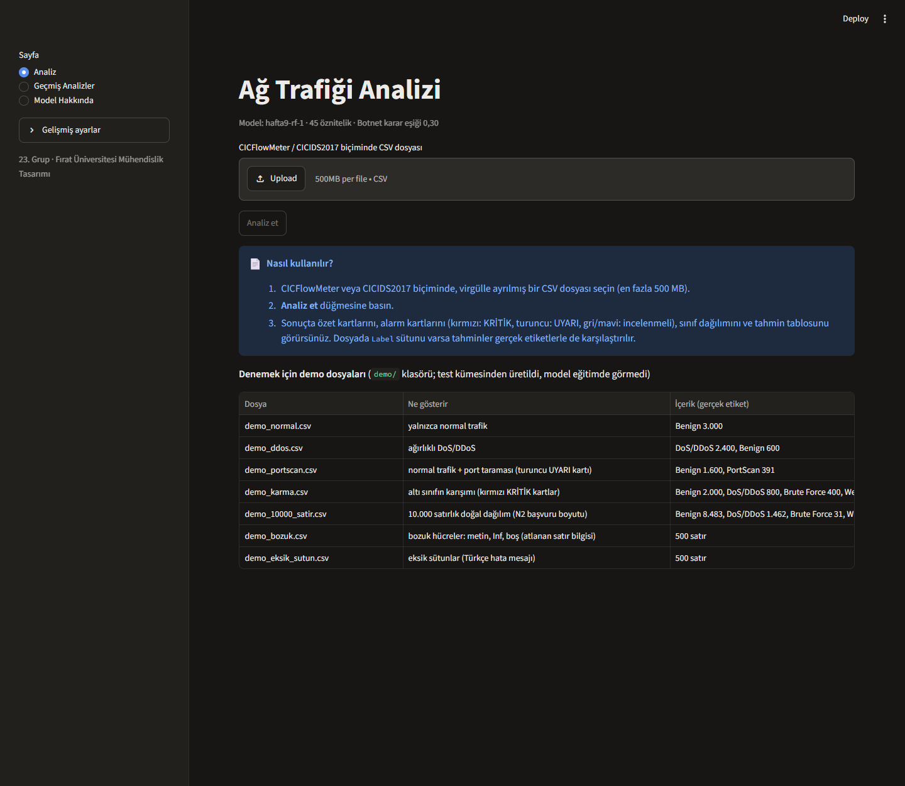
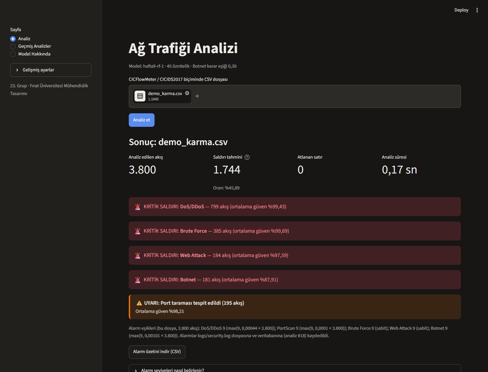
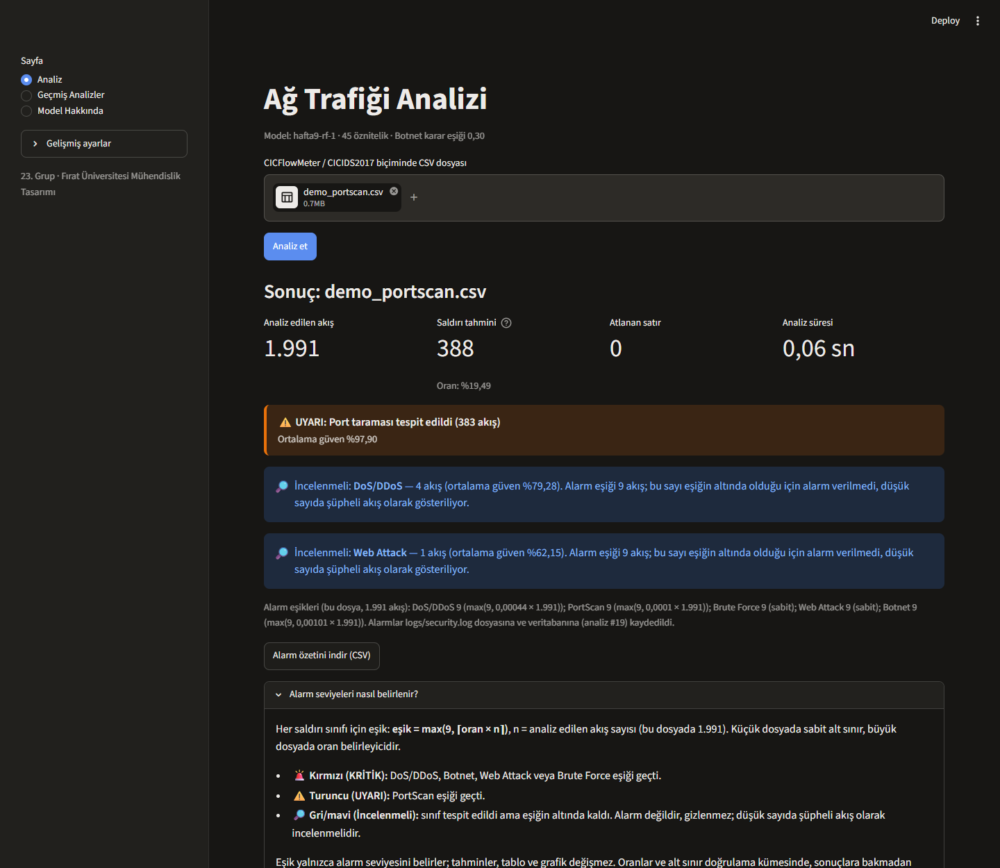
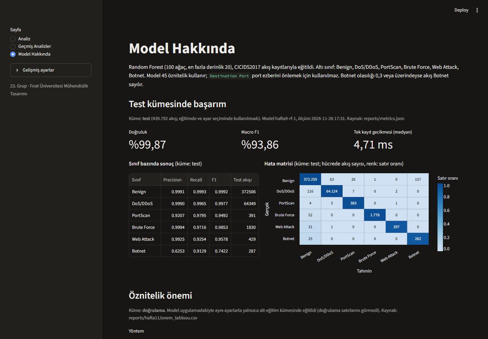
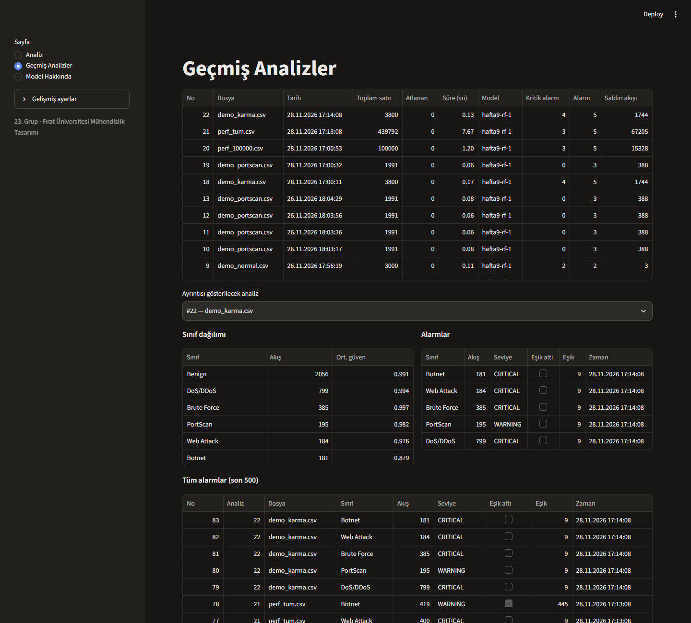

# Ağ Trafiği Verilerinden Siber Saldırı Türlerinin Sınıflandırılması

Fırat Üniversitesi Bilgisayar Mühendisliği · Mühendislik Tasarımı · 23. Grup
(Murat Tunç, Mehmet Emre Erdoğan, Bilal Demir)



## Amaç

Ağ akış kayıtlarından (CICFlowMeter çıktısı) normal trafiği ve beş saldırı türünü ayırt eden bir
makine öğrenmesi sistemi. Sistem bir CSV dosyasındaki her akış için bir sınıf ve güven skoru
üretir. Kritik bir saldırı bulduğunda alarm verir, alarmı `logs/security.log` dosyasına ve
SQLite geçmişine yazar. Sonuçlar bir Streamlit arayüzünde gösterilir.

Sınıflar (6): **Benign, DoS/DDoS, PortScan, Brute Force, Web Attack, Botnet.**

## Veri seti

[CICIDS2017](https://www.unb.ca/cic/datasets/ids-2017.html), `MachineLearningCSV.zip` içindeki
8 CSV dosyası. Birleşik ham veri 2.830.743 akıştır; ayrıntılar `reports/rapor_tablolari.md` dosyasında.

- Orijinal etiketler 6 sınıfa eşlenir (`src/config.py::map_label`). Infiltration ve Heartbleed
  (toplam 47 akış) kapsam dışıdır.
- `Destination Port` çıkarılır. Amaç modelin port ezberlemesini önlemek; ezber 8. haftada
  Deney 3 ile doğrulandı. Birebir kopya sütun `Fwd Header Length.1` yüklemede silinir.

## Boru hattı (veri sızıntısı olmadan)

1. 8 CSV birleştirilir. Kapsam dışı sınıflar, Inf/NaN içeren satırlar ve **tekrarlayan satırlar**
   silinir: 2.830.743 → 2.198.957 satır. Sabit 8 sütun çıkarılır.
2. Katmanlı %80 eğitim / %20 test bölmesi yapılır (1.759.165 / 439.792 satır). **Bundan sonra test
   kümesine dokunulmaz.** Ayar seçimleri, eğitimin içinden ayrılan doğrulama kümesinde yapılır
   (alt-eğitim / doğrulama).
3. Aşağıdaki adımlar **yalnızca eğitim kümesinde** yapılır:
   - Öznitelikleri aynı ama etiketi farklı olan satır grupları silinir.
   - Korelasyonu 0,95'in üstünde olan öznitelikler elenir; **45 öznitelik** kalır.
   - `StandardScaler` eğitim kümesine fit edilir.
   - SMOTE ile küçük sınıflar 10.000 örneğe tamamlanır. En büyük sınıf asla çoğaltılmaz.
4. Random Forest eğitilir (100 ağaç, en fazla derinlik 20, `min_samples_split=5`,
   `random_state=42`). Karar kuralı: **Botnet olasılığı ≥ 0,30 ise Botnet**, değilse kalan
   sınıflardan en olası olan (`src/evaluate.py::predict_classes`).

Ayarlar 8. haftada doğrulama kümesinde seçildi (`reports/hafta8/rapor_tablolari_hafta8.md`):
SMOTE 10.000, çakışan grupları silme, port yok, Botnet eşiği 0,30. Tüm ayarlar `src/config.py` dosyasındadır.

## Sonuçlar (test kümesi, 439.792 akış)

Kaynak: `reports/rapor_tablolari.md` ve `reports/metrics.json` (model `hafta9-rf-1`).

| Ölçüt | 7. hafta (ilk pipeline) | 9. hafta (uygulamadaki model) | Hedef |
| --- | --- | --- | --- |
| Doğruluk | %99,85 | %99,87 | ≥ %95 (N1) |
| Macro F1 | %93,04 | %93,86 | — |
| Botnet F1 | %68,19 | %74,22 | ≥ %90 (N1, kritik sınıf) |
| Tek kayıt gecikmesi (medyan) | 3,528 ms | 4,711 ms | < 50 ms (N2) |

Uygulamadaki modelin sınıf bazında sonuçları:

| Sınıf | Precision | Recall | F1 | Test akışı |
| --- | --- | --- | --- | --- |
| Benign | %99,91 | %99,93 | %99,92 | 372.506 |
| DoS/DDoS | %99,90 | %99,65 | %99,77 | 64.349 |
| PortScan | %92,07 | %97,95 | %94,92 | 391 |
| Brute Force | %99,94 | %97,16 | %98,53 | 1.830 |
| Web Attack | %99,25 | %92,54 | %95,78 | 429 |
| Botnet | %62,53 | %91,29 | %74,22 | 287 |

N1'in kritik sınıflarda F1 ≥ %90 koşulu **Botnet'te karşılanmıyor**. Diğer kritik sınıflarda karşılanıyor.

**Performans (10. hafta, `reports/hafta10_sonuclar.md`)**
Ölçümler i5-12500H, 31,8 GB RAM ve Windows 11 üzerinde yapıldı.
- **N2:** tek kayıt `predict()` medyanı ortalama 4,48 ms (en kötü 5,10 ms). 10.000 satır 0,169 sn sürdü.
- **N3:** tepe bellek en kötü 1.058,3 MB (komut satırı, tüm test kümesi). Streamlit sürecinde 1.290,4 MB (tek ölçüm).

**Botnet analizi (11. hafta, `reports/hafta11_sonuclar.md`)**
- Doğrulama kümesinde Botnet'e kaçan Benign akışların %86,7'si aynı kısa akış şablonuna uyuyor.
  Bu şablon eğitimde hem Benign hem Botnet akışlarında görülüyor.
- Botnet'in SMOTE ile daha az çoğaltılması önceden yazılmış ölçüte göre kazanç sağlamadı.
  Ayar değişmedi ve test kümesi yeniden kullanılmadı.

## Alarm kuralı

- **Seviyeler:** DoS/DDoS, Botnet, Web Attack ve Brute Force → CRITICAL (kırmızı kart). PortScan →
  WARNING (turuncu kart). Her analizde sınıf başına tek log satırı yazılır.
- **Eşik:** bir sınıfın eşiği `max(9, ⌈oran × n⌉)`; n = analiz edilen akış sayısı.
  Oranlar: DoS/DDoS 0,00044, Botnet 0,00101, PortScan 0,0001, Brute Force 0, Web Attack 0.
  Eşiğin altında kalan sınıf **gizlenmez**. Gri/mavi "düşük sayıda şüpheli akış, incelenmeli"
  kartıyla gösterilir ve günlüğe WARNING olarak yazılır. Tahminler değişmez.
- **Seçim:** N_min = 9 9. haftada, oranlar 10. haftada doğrulama kümesinde, sonuçlara bakılmadan
  önce yazılmış bir ölçütle seçildi (`reports/hafta10/esik_secim_olcutu.md`).
  Kural tek yerde: `src/alarm.py::alarm_threshold`.

## Windows kurulumu

### 1. Python 3.11 kurun
[python.org/downloads](https://www.python.org/downloads/) adresinden **Python 3.11** indirin.
Kurulumun ilk ekranında **"Add python.exe to PATH"** kutusunu işaretleyin.

### 2. Proje klasöründe PowerShell açın
Zip'i açın (ör. `C:\projeler\siber-saldiri-siniflandirma`). Klasörün içinde boş bir yere
sağ tıklayıp **"Terminalde aç"** seçin.

### 3. Sanal ortam ve kütüphaneler
```powershell
py -3.11 -m venv .venv
```
```powershell
.venv\Scripts\Activate.ps1
```
```powershell
pip install -r requirements.txt
```
`Activate.ps1` "betik çalıştırma devre dışı" hatası verirse bir kez şunu çalıştırıp `Y` deyin.
Sonra etkinleştirme komutunu tekrarlayın:
```powershell
Set-ExecutionPolicy -Scope CurrentUser RemoteSigned
```
Satırın başında `(.venv)` görünüyorsa ortam etkin demektir.

### 4. Veri setini yerleştirin
CIC-IDS2017 sayfasından **MachineLearningCSV.zip** dosyasını indirin. İçindeki
`MachineLearningCVE` klasöründe bulunan **8 CSV dosyasını** `data\raw\` klasörüne kopyalayın.

### 5. Modeli eğitin
Önce hızlı bir deneme yapın (%5 örneklem; bu sonuçlar rapora yazılmaz):
```powershell
python run_pipeline.py --sample-frac 0.05
```
Sonra asıl çalıştırmayı yapın (tam veri):
```powershell
python run_pipeline.py
```
Model ve yardımcı dosyalar `artifacts/` altına yazılır. Model dosyası GitHub'da yoktur.

## Uygulamayı çalıştırma

```powershell
streamlit run app.py
```
Tarayıcıda `http://localhost:8501` açılır. Yükleme sınırı 500 MB'tır (`.streamlit/config.toml`).

- **Analiz:** CSV yükleyip **Analiz et**'e basın. Ekranda özet kartları, alarm kartları, sınıf
  dağılımı, güven skorlu tahminler ve indirme düğmeleri (tüm tahminler ve alarm özeti) görünür.
  "Alarm seviyeleri nasıl belirlenir?" kutusu bu dosyadaki eşikleri gösterir. `Label` sütunu
  olan dosyalarda tahminler gerçek etiketlerle karşılaştırılır ve hata matrisi ısı haritası gösterilir.
- **Geçmiş Analizler:** önceki analizler ve alarmlar (`data/analizler.db`).
- **Model Hakkında:** test kümesi sonuçları, doğrulama kümesinde öznitelik önemi ve bilinen sınırlar.
  Sayılar `reports/` dosyalarından okunur.
- **Gelişmiş ayarlar** (kenar çubuğu): N_min değiştirilebilir. Varsayılan değer dışında bir değer
  seçilirse sonuçta not gösterilir.

| | |
| --- | --- |
|  |  |
| `demo_karma.csv`: kırmızı KRİTİK kartlar | `demo_portscan.csv`: turuncu UYARI kartı ve eşik tablosu |
|  |  |
| Model Hakkında | Geçmiş Analizler |

Tüm ekran görüntüleri: `docs/img/` (liste ve açıklamalar `reports/hafta11_sonuclar.md` içinde).

### Demo dosyaları

`demo/` klasöründeki dosyalar test kümesinden üretildi (model eğitimde bunları görmedi) ve
gerçek etiketi içerir: `demo_normal.csv`, `demo_ddos.csv`, `demo_portscan.csv`, `demo_karma.csv`
ve `demo_10000_satir.csv`. Hata yönetimini denemek için `demo_bozuk.csv` ve `demo_eksik_sutun.csv` de var.
İçerikleri `demo/demo_icerik.json` dosyasında. Demo dosyalarını yeniden üretmek veya arayüz
açmadan kontrol etmek için:
```powershell
python scripts/make_demo_files.py
```
```powershell
python scripts/check_demo_files.py
```

## Testler

```powershell
python -m pytest -q
```
Sahte küçük bir model ve sahte veriyle çalışır; gerçek veri gerekmez. Test dosyaları:
- birim testleri,
- uçtan uca testler (CSV → tahmin → SQLite → security.log),
- Streamlit arayüz testleri (`streamlit.testing` AppTest).

Testler `data/analizler.db` ve `logs/security.log` dosyalarına yazmaz.

## Deneyler ve raporlar

| Hafta | Betik | Sonuç |
| --- | --- | --- |
| 8 | `experiments/run_experiments.py`, `run_followup.py` | `reports/hafta8/` |
| 9 | `experiments/alarm_threshold.py` | `reports/hafta9/` |
| 10 | `experiments/ratio_threshold.py`, `scripts/measure_memory.py` | `reports/hafta10/`, `reports/hafta10_sonuclar.md` |
| 11 | `experiments/botnet_importance.py`, `botnet_template_check.py`, `botnet_smote.py` | `reports/hafta11/`, `reports/hafta11_sonuclar.md` |

Ayar seçen her deneyin seçim ölçütü, deney çalıştırılmadan önce yazılıp commit edildi.
Test kümesi yalnızca seçilen ayarın son ölçümünde kullanıldı.

## Bilinen sınırlar

- **Botnet:** test F1 %74,22 (precision %62,53). Bazı normal akışlar akış düzeyindeki
  özniteliklerde Botnet akışlarından ayırt edilemiyor (11. hafta analizi). Botnet'i ayırt edebilecek
  hedef adres ve tekrar düzeni gibi bilgiler akış özniteliklerinde yok.
- **PortScan eşiği:** 10. hafta test ölçümünde 100.000 satırlık dosyalarda yanlış UYARI oranı
  %13,6 çıktı (doğrulamada %3,1).
- **Büyük dosyada eşik:** `max(N_min, oran × n)` büyük dosyalarda yüksek eşik verir. Az sayıda
  gerçek DoS/Botnet akışı "incelenmeli" olarak gösterilebilir. Tüm test kümesinde doğal orandaki
  Botnet KRİTİK almıyor (419 tespit, eşik 445).
- **Aynı veri setinden test:** model CICIDS2017'nin ayrılmış test kümesiyle ölçüldü. Farklı bir
  ağda veya farklı CICFlowMeter sürümüyle çıkarılan akışlarda başarı düşebilir.
  Canlı deneme planı: `docs/canli_demo_plani.md`.

## Proje yapısı

```
run_pipeline.py        # tek komutla eğitim ve değerlendirme
app.py                 # Streamlit arayüzü
src/config.py          # yollar, sınıf eşlemesi, hiperparametreler, alarm seviyeleri ve oranları
src/data_loader.py     # CSV okuma ve birleştirme
src/preprocess.py      # temizlik, bölme, çakışma silme, öznitelik seçimi, ölçekleme, SMOTE
src/evaluate.py        # metrikler, Botnet eşik kuralı, hata matrisi, gecikme ölçümü
src/inference.py       # yeni CSV için doğrulama + tahmin + güven skoru
src/database.py        # SQLite analiz geçmişi
src/alarm.py           # security.log, alarm üretimi ve eşik kuralı
src/service.py         # analiz akışı: tahmin -> veritabanı -> alarm
experiments/           # deney betikleri (8-11. hafta)
scripts/               # demo dosyası üretimi, bellek ölçümü
demo/                  # test kümesinden demo CSV'leri
docs/                  # ekran görüntüleri, canlı demo planı
tests/                 # birim, uçtan uca ve arayüz testleri
```
